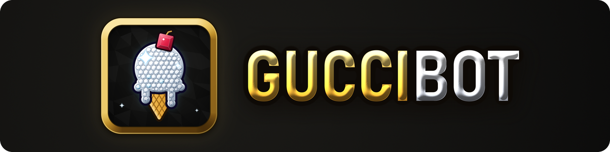

<h1 align="center"></h1>

<!-- GitHub's social preview, the picture a link to this repo shows, is docs/images/github-social-preview.png (1280 x 640). GitHub can't take it from the repo: Nigel uploads it in the repo's Settings > General > Social preview > Edit > Upload an image. -->

> Frame perfect. Ice cold. Brrr Brrr Brrr.

It's Gucci. GucciBot is a Geometry Dash macro bot (a [Geode](https://geode-sdk.org/) mod) that records your inputs frame-perfectly and plays them back exactly, built on top of [Silicate](https://git.puppy.lgbt/silicate/silicate)'s physics engine. It also measures how many frames you had for every click, finds its own way through a level, renders straight to video and trains you on the hard parts. Think of it as a very expensive, very icy ghost of your best run — except the ghost never drops a frame, never has an off day, and definitely never forgets its jewelry. So icy.

**[guccibot.net](https://guccibot.net)** · [Download](https://github.com/Nigelx1/GucciBot/releases/latest) · [Discord](https://discord.gg/m95NUPdbpJ)

## Get it

The newest release is **2.0.0**. It comes as **two files on the same release**, one for each Geometry Dash version. Download only the one for your game.

| Your game | Your Geode | Download | Runs on |
|---|---|---|---|
| **GD 2.2081** | **Geode 5.10.1** or a later 5.x | `nigelx1.guccibot2208.geode` | Windows, Mac (Apple silicon and Intel), iPhone, iPad and Android (32- and 64-bit) |
| **GD 2.2091** | **Geode 6.0.0-beta.1** or a later Geode 6 | `nigelx1.guccibot2209.geode` (preview) | Windows only, for now |

The number in each name is the GD version it's for: **2208** is GD 2.2081, **2209** is GD 2.2091. The 2208 file is about 227 MB and the 2209 file about 228 MB, since the renderer, the music and the JMF Trainer's video ride along.

| File | SHA-256 | VirusTotal |
|---|---|---|
| `nigelx1.guccibot2208.geode` | `acb0b0c145bde82f6d45068bad6cd1b702fed93b041666cfd3d42fb6f3d9a586` | [0 of 62 engines](https://www.virustotal.com/gui/file/acb0b0c145bde82f6d45068bad6cd1b702fed93b041666cfd3d42fb6f3d9a586) |
| `nigelx1.guccibot2209.geode` | `3bd29a9afc4fd905ad6a6c31695154e3231bea0b9f65ea02c333001523aeed64` | [0 of 65 engines](https://www.virustotal.com/gui/file/3bd29a9afc4fd905ad6a6c31695154e3231bea0b9f65ea02c333001523aeed64) |

Check your copy: `certutil -hashfile nigelx1.guccibot2208.geode SHA256` on Windows, `shasum -a 256 nigelx1.guccibot2208.geode` on a Mac (use the other file's name for the 2209 file).

### Which GD and Geode do I have?

Geode tells you both.

- **Your Geode:** open Geode's mod list. Geode itself is in the list of installed mods, with its version under its name.
  - **Geode 5** (5.10.1 or later) means GD 2.2081: take the **2208** file (`nigelx1.guccibot2208.geode`).
  - **Geode 6** (6.0.0-beta.1 or later) means GD 2.2091: take the **2209** file (`nigelx1.guccibot2209.geode`). Geode 6.0.0-beta.2 passes Geode's own version check for it, but we haven't run the preview on beta.2 yet.
  - A Geode 6 alpha: the preview won't load on it. Update Geode to 6.0.0-beta.1 or later first.
- **Your GD:** open the `geode/logs` folder in the game's folder (next to `geode/mods`) and open the newest log. Near the top, Geode writes a line like `Running Geode v5.10.1 in Geometry Dash v2.2081 on Windows`. The number after "Geometry Dash v" is your GD version.
- **If that line says "forward compatibility mode"**, your game updated to 2.2091 but your Geode is still Geode 5. Neither GucciBot file loads like that. Install [Geode 6](https://github.com/geode-sdk/geode/releases) (6.0.0-beta.1 or newer; the Windows installer is on its release page) and take the 2209 file, or play on GD 2.2081 with Geode 5 and take the 2208 file.

### Install

1. Download the file for your GD from the [latest release](https://github.com/Nigelx1/GucciBot/releases/latest).
2. In the game, open Geode's mod list, press the gear for Geode's settings, press **Install From File** and pick the file. (Geode saves it in the mods folder as `nigelx1.guccibot.geode`, whichever file it was.)
3. If GucciBot is already installed, Geode asks whether to replace it. Press **Replace** to update.
   **But if Geode first says the mod "can not be installed"**, you picked the other GD's file. Press **OK**, then **Cancel** on the next box. **Replace** there would delete your working GucciBot and put in one that won't load. If GucciBot wasn't installed yet, Geode 6 may install the wrong file anyway after **OK**; it then shows as Outdated: delete it from the mods folder and install the right one.
4. Restart the game.
5. Open GucciBot:
   - **Windows:** press **Left Alt**. You can change the key in Settings > Keybinds.
   - **Mac:** press **Option**, or the **GucciBot** logo in a level's pause menu.
   - **iPhone, iPad and Android:** pause a level and press the **GucciBot** logo (the iced cone) in the bottom-right corner of the pause menu.

### Keep exactly one GucciBot file

Both files are the same mod (`nigelx1.guccibot`), built for two different games. Your mods folder holds exactly one of them.

- **The wrong one doesn't load.** Geode marks it **Outdated** in the mod list, with the GD or Geode version it was built for (for example "Outdated (GD 2.2091)" on a 2.2081 game).
- **Two at once conflict.** Geode takes one and lists the other as invalid. If the one it took is the other GD's file, it shows as Outdated and GucciBot doesn't start at all; otherwise GucciBot's setup check points out the extra file. Either way, delete the file that isn't for your GD.
- **Putting a file in the mods folder yourself** (**Open Mods Folder**, next to Install From File)? Delete the old GucciBot file first, whatever its name: `nigelx1.guccibot.geode`, `nigelx1.guccibot2208.geode` and `nigelx1.guccibot2209.geode` all count.
- **Playing both GD versions?** Keep each version's file in that game's own mods folder, never both in one.

**Turn off ToastyReplay Lite, Silicate and Antic's Counter first.** GucciBot can't run live alongside any of them (ToastyReplay Lite crashed macro playback; Silicate and Antic's Counter patch the same spots in the game GucciBot does), so while one is enabled GucciBot stands down and says why. Turn the other one off or uninstall it, restart, and you're in.

### GD 2.2081: every platform

Windows is home, and gets the most testing. macOS, iOS and Android are newer: the Android build has run on a phone, the rest has had little testing, the Pathfinder runs off Windows without the trigger model (not tested on a device yet), and rendering and Video Mode work on Windows and Mac (the Mac's are new in 2.0 and not tested on a Mac yet; [the full list](about.md#platforms)). The Mac build runs on Intel Macs too, new in 2.0, but nobody has run it on one yet.

### GD 2.2091: the Windows preview

The preview is the same GucciBot, built from the same code for GD 2.2091 and Geode 6. It's **Windows only** for now, and it has everything in 2.0 except:

- **The Pathfinder.** Its page says it isn't on GD 2.2091 yet. It comes in **2.0.1**.
- **Some tick rates.** 240 TPS and any rate from 162 TPS up work: in our tests on earlier builds of the preview, they recorded and replayed to exactly the same end. Tick rates under 162 TPS, TPS changes inside a macro, and High TPS precision come in **2.0.1**. A macro made under 162 TPS plays at 240 instead, with a notice, so it won't play back the same.
- **The trigger model behind the look-aheads.** Show Trajectory, Frame extrapolation, Prevent death's look-ahead, Best tick, the Survival Indicator, Possible positions and the sub-tick preview work as they do on a Mac: moving objects keep their current speed.
- **Mac, Android, iPhone and iPad on 2.2091.** Mac and Android come in **2.0.1**. iPhone and iPad come later, once Geode's iOS bindings for 2.2091 have what GucciBot needs. Until then, those platforms have GucciBot on GD 2.2081 only.

Macros use the same file format on both versions, and in our tests on earlier builds of the preview they carried over: 13 macros, across every game mode, ended the same way on GD 2.2081 and on 2.2091. On slopes the two can differ by far less than a pixel, so a frame-perfect slope part is worth one check. A macro made on the other GD version says so when you load it.

Stuck, or got a question? Ask in [the Discord](https://discord.gg/m95NUPdbpJ). Found a bug? [Open an issue](https://github.com/Nigelx1/GucciBot/issues/new/choose).

## What it does

- **Records and plays back, frame-perfect.** The engine is a port of Silicate's, reconciled function by function. Practice checkpoints are captured whole, so a macro recorded through respawns plays back exactly like one recorded straight through, and a level with random triggers replays the same way every time. Frame advance, backwards stepping, intentional deaths, mirror inputs and RNG lock come with it.
- **GBR6, the hypercompressed macro format.** 2 bytes an input (yBot-sized files for human gameplay), a wave or ship tap stored as one entry, and a steady autoclicker run stored as its pattern instead of click by click.
- **Other bots' macros, in the game.** 27 formats read, among them GDR and GDR2, Silicate .slc, TcBot, ToastyReplay .ttr3, yBot, xdBot, Mega Hack, Echo and GucciBot 1.x's old .brrr, and 21 written back out with **Export as**. Drop one in the replays folder and it converts in one press; the original is kept. The full list is in [about.md](about.md#other-bots-macros).
- **Calculate, the frame-window analyzer.** For every click, how many frames you actually had, measured against the real game engine, not a guess. It runs on anticroom's Silicate analyzer: Time-Based and Recovery Range, windows finer than a single frame, color bands with their own marker shapes, images, pulses and sounds, and an in-level legend. **Share my windows** saves a picture of a macro's windows, bands and L* to show off, plus a .zip of the macro and its windows that anyone can load with Import a macro. **Windows by hand** lets you type any input's window yourself, and a tight click right after another input also gets Juice's Alignment-Independent count, "my suggestion is x frames", flagged in the Frame Editor. The whole frame-window trend started with NaN GD, and the L* precision number GucciBot puts on a macro comes from NaN GD's formula, published at [nandl.pages.dev](https://nandl.pages.dev/#formula). NaN GD is careful to say frame windows alone don't determine difficulty, and GucciBot says the same. Hitborders and their possible-positions band were NaN GD's ideas too; NaN GD isn't involved.
- **Pathfinder: it makes the macro for you.** Open a level with nothing recorded and start it: it plays the level itself until it reaches the end, then saves the run as a macro named after the level. The default engine is Absent's, from Absense, ported in whole: before each input it runs copies of the player ahead through the real level, and it goes back when it hits a dead end. While it thinks, **Show the search** draws the paths it's trying, with the best one brighter. GucciBot's own Classic search is still there too. Planning tools come with the search: **Show the level map** draws every gap, choice and moving part, **Show the planned route** draws its way through the whole level, and **Follow the planned route** has it take that route. The **AI** engine is new and early: a small network that comes with the mod decides each click. It's weak, and the search is the strong one. **Rotate triggers** (experimental, off by default, Windows only for now) has the search's copy of the level turn blocks exactly like the game's rotate triggers do; it can make the search slower on some levels. Off Windows it runs without the trigger model (not tested on a device yet).
- **Trainers.** Nigel's Jupiter My Favourite Trainer, and a second Trainer for any macro you pick: a click bar with your own presses next to the macro's (or an osu!taiko-style lane that judges every press), ghosts of the macro and of your best attempt, segments to name and loop, stats with a death heatmap, synced music, and **Video Mode** to review a run against a video (Windows and Mac). Plus **Click Indicators**: the macro's clicks coming at you over the level, with every option of Bogdaner09's free mod, scored Perfect / OK / Miss.
- **Practice tools.** The **Survival Indicator** (does clicking right now survive?), Show Trajectory, Prevent Death and Find Best Tick, noclip with an accuracy readout, hitboxes, the macro's path drawn in the level, and an autoclicker with its own hold, release and clicks per hold for each player.
- **Macro tools.** The **Frame Editor** (drag, stretch or shorten every press, with undo), **Check Macro** (lists anything that would desync playback), a diff viewer, trim and merge, TPS changes mid-macro, bot settings presets, and autosave at level end.
- **Rendering** (Windows and Mac). Gameplay straight to a video file, no recorder needed: a hardware encoder picked for your graphics card, anticroom's intro card, four separate audio tracks if you want them, the frame-window markers and cues baked in, fades at both ends, and presets (**Showcase** sets up 8K60 lossless in one press, and **Basic** an everyday 1080p60 render). It runs on FFmpeg 8.0.1 (GPL v3), bundled in the package; where those DLLs come from and their source: [guccibot-build-files](https://github.com/Nigelx1/guccibot-build-files).
- **Auto safe mode**, on by default: while a cheat is on (a macro playing, noclip, speedhack, Click Indicators and the rest), an attempt doesn't count. No completion, no new best, nothing sent to the servers. A **setup check** warns about the settings that break the engine, and the **Disable bot** switch takes GucciBot out of the game without a restart.
- **And the rest.** A **search box** for the whole menu (type noclip and it takes you to the switch; Ctrl+F), a **Windows layout** with every card in its own window, click sounds (the built-in Clickbot pack or your own), an **Icon hack** (every icon, color, trail, death effect and ship fire yours to pick; it only changes how you look), a HUD with CPS, 20 hotkeys, **Compact Mode** to keep the bot at hand while you play, editor tools, an update check, and **Assistant Access**, an optional local server an AI assistant on your computer can read and drive the bot through (off by default).
- **Themes.** 24 built-in ones, each saving macros under its own extension, a full editor for your own, and BIG BRRRR. The roster is [below](#themes).

Every feature and setting is in [about.md](about.md), the page Geode shows for the mod, and on [guccibot.net](https://guccibot.net).

### New since 2.0.0-beta.5

Everything below is new in 2.0. Not all of it has been tested on every platform: see [GD 2.2081: every platform](#gd-22081-every-platform).

- Four more themes: **RondoBot**, **SolarBot**, **JupiterBot** and **GBot**, a disguise.
- **Explicit content** (Settings > Look), off by default: until it's on, no theme song plays (a song you add to the BIG BRRRR folder or a custom theme still does), and the themes' few suggestive lines read clean. More under [Themes](#themes).
- **Legit only** (Hacks > Gameplay): one switch that turns off everything that counts as a cheat and gives it all back when you turn it off. While it's on, no macro plays, so turn it off to render one.
- Safe mode's cheat list now follows the Demonlist's rules for allowed mods: recording a macro, hitboxes shown while you play, Layout mode, No Mirror while it applies, the Survival Indicator, the HUD's Touching orbs and Time warp, a trainer's click bar or Video Mode over its own level, and the Pathfinder's level map, planned route and next gate count as cheats. The cheat mark shows on the end screen too, and renders never show it. In plain play, with no macro recording or playing, GD keeps its own random.
- GucciBot stands down while anticroom's Antic's Counter is enabled, as it does for ToastyReplay Lite and Silicate.
- Calculate's **Default Look** (drawn like the counter in NaN GD's videos), your own text in the level over any input, presets (Balanced, Accuracy, Absolute), **Max window** and **Ship steering** (based on anticroom's Antic's Counter and following its newer, stricter rule, on by default: a ship timing that kills you still counts if taps a person could make get you back to the macro's inputs and you survive its next click). It also measures closer to anticroom's original: its tests end on the same tick anticroom's do, a test that starts just before a slope gets the slope's launch, as real play does, sub-tick tests move the next inputs along first, and Juice's suggestion pass finishes sooner, often much sooner on long levels.
- The Pathfinder page gets an **Engine** choice. **Search**, the default and by far the stronger engine, is the pathfinder beta.5 had, made stronger. It adds **Route drives** (experimental), a much faster simulation of busy levels, **Exact start flags**, every search cold unless **Remember solutions** is on, and a backup plan for a run that's stuck: before it gives up, it tries pressing the orbs its copies of the player pass. In Claude's test runs it has beaten all 22 of RobTop's main levels from a cold start (Deadlocked on an online copy of it). **AI** is an early AI that comes with the mod: a small network, trained on human play and then on its own runs, decides each click. It's weak and beats very few levels. **Practice**, on by default, keeps it trying one: with it, the AI beat Stereo Madness, its own training level, after 7 seconds of practice. With Practice off it plays alone and learns from its own best runs, one level at a time (slow, with small gains so far).
- **The Trainer's lane** (Click Trainer > Style > Lane), Juice's osu!taiko-style design: the macro's clicks scroll into a hit marker as notes sized by their frame window, holds whose release matters are sliders, and each press is judged as it lands, on the card or over the level. The old bar stays the default. **Delay** (both styles, shared by both trainers) draws the trainer up to 200 ms ahead of the game for a screen that lags, or up to 100 ms behind; the judging still goes by when the game got your press, and Video Mode's bar doesn't use it.
- **Record from where a macro is**: switch Mode to Record while a macro plays and it carries on from there, with the rest cut, so a macro can be added to or its end redone.
- **Hitborders**: every hitbox grown by yours, so you're a point and the gaps drawn are the room your center really has, from the game's own collision rules, with a hotkey of its own. They look like NaN GD's: red, blue and green at half fill, used orbs, pads and portals still drawn (or hidden, with a switch), a thin white path, and the level darkened under the borders so they stand out. **Possible positions** (off by default) adds NaN GD's yellow band while a macro plays: where your center could go if one click at a time landed anywhere in its window, with the other clicks kept where they are, estimated ahead of you from hidden copies of your player.
- **Search the menu**: a box on every page's title line (not in Compact Mode). Type noclip, a theme's name or an old name like path preview and pick a result: the menu opens that page and tab, scrolls to the control and outlines it. Ctrl+F jumps to it.
- **Share my windows** on the Calculate card: a picture of the macro's frame windows (bands, the tightest clicks, L*) in your theme's colors, saved to the `shares` folder, with a .zip of the macro and its windows beside it that Import a macro loads, so someone else sees the same windows.
- **A Windows layout** (Settings > Look > Layout): a bar across the top and every card in a window of its own, tiled into columns, dragged and collapsed as you like, and kept after a restart. Pages stays the default.
- The setup check names a second GucciBot file in the mods folder, which Geode lists as invalid, and says which one to delete.
- **Icon hack** (Hacks > Visual): every icon, color, trail, death effect and ship fire is yours to pick while it's on. It only changes how you look, so safe mode and Legit only don't count it as a cheat, and nothing else unlocks.
- **Block inputs during playback** (on by default, as in Silicate), an intro card with every line yours to edit, BrrrBot's snow, Intel Macs (in the package, but nobody has run it on an Intel Mac yet), BIG BRRRR switching to the new theme's song when you pick one mid-drop, and fixes: a release and a press in one tick are recorded once (beta.5 could record extra presses there), reopening a level with random triggers no longer crashes, and the Safe mode switch works.

## Themes

Pick one on the **Themes** page, or build your own there: **New custom theme** opens a full editor (colors, identity, quotes, your own BIG BRRRR track) for exactly this occasion.

**Explicit content (off by default).** Some themes come with songs that have explicit lyrics, plus jokes and quotes to match. All of it stays off until you turn on **Explicit content** in Settings. It's suggestive lyrics and material, nothing graphic.

<details>
<summary>The full roster: 24 themes</summary>

| Theme | Extension | Colors |
|---|---|---|
| GucciBot | `.brrr` | Gold + Black |
| ToosiiBot (LSU / Syracuse / Sac State) | `.toosii` | Purple+Gold / Orange+Navy / Green+Gold |
| JaBot | `.ja` | Navy + Light Blue |
| GiddeyBot | `.giddey` | Thunder Blue + Orange |
| BamBot | `.bam` | Heat Black + Red |
| SexyyBot | `.sexyy` | Hot Pink + Purple |
| JuiceBot | `.juice` | Coral + Teal |
| ButlerBot | `.butler` | Bulls Red + Black |
| SaweetieBot | `.saweetie` | Hot Pink + Plum |
| MaybachBot | `.maybach` | Platinum + Black |
| RomoBot | `.romo` | Cowboys Navy + Silver |
| GrizzleyBot | `.grizzley` | Charcoal + True Red |
| **Red Kingdom** | `.redkingdom` | Blood red that *pulses*, because a static color wasn't intense enough |
| LemonadeBot | `.lemonade` | Bright Yellow + Warm Black |
| BrrrBot | `.icebrrr` | Icy Blue + Navy, with live snow falling behind the panel |
| WakaBot | `.waka` | Grove Green + Black |
| YoungstaBot | `.youngsta` | Black + Red (223) |
| KnockerzBot | `.knockerz` | Teal + Black |
| RondoBot | `.rondo` | Celtics Green + White, on the TD Garden's parquet with a gold trim |
| SolarBot | `.solar` | Sun Yellow + Deep Orange, with Janet (Solar Flare's sun) in the corner of its dark sky and the planets riding their orbits around her |
| JupiterBot | `.jupiter` | JMF Yellow + Night Blue: the JMF Trainer's star chart at night, moon dial and skyline, on every page |
| GBot | `.gbot` | Charcoal + Steel Blue, to hide true greatness from da opps |
| *Yours* | — | Whatever you want. That's the point. |

SolarBot, JupiterBot and GBot have no BIG BRRRR; it comes back with any other theme, as you left it. GBot moves in silence: the menu answers to GBot, the theme picker ducks into a plain dropdown in Settings > Look, and the JMF Trainer and Credits pages, the BIG BRRRR card and the macro list's theme tags lie low until you switch back. New macros save as `.gbot`. Geode's mod list still knows the real name, so don't let anyone scroll that far.

GucciBot's own color is gold, for the record. Yellow everything this time, you know what I'm talking about? Yellow rims. Yellow big booty yellowbones, ha. Yellow Lambs, yellow MPs, yellow watch. Yellow charm ring, chain. Yellow living room set.

Also in Settings: **BIG BRRRR**, a core feature of this mod, with **Shake** and **Flicker** to make the whole menu react to the track's actual bass in real time. You'll know it when you feel it.

The themes' songs play with **Explicit content** on (Settings > Look), and a track in the BIG BRRRR folder plays either way.

</details>

## Status

**2.0.0** is the newest release: two files, one for GD 2.2081 on every platform and a Windows preview for GD 2.2091 ([which one?](#get-it)). Work after it lands on `master`, where every push builds both files.

What's tested and what isn't, plainly:

- **Windows on GD 2.2081** is home and gets the most testing.
- **Mac, iPhone and iPad** have had little testing, and **Android** has run on a phone. The Mac build runs on Intel Macs too, but nobody has run it on one yet. Rendering and Video Mode on a Mac, and the Pathfinder off Windows, haven't been tried on a device.
- **The GD 2.2091 preview** is Windows only, without the Pathfinder, tick rates under 162 TPS, TPS changes inside a macro or High TPS precision until 2.0.1 ([the details](#gd-22091-the-windows-preview)).
- **The Pathfinder's AI engine** is early and weak: a small network that comes with the mod and beats very few levels. The search engine, the default, is the strong one.

Next up is **2.0.1**: the Pathfinder, tick rates under 162 TPS, TPS changes inside a macro and High TPS precision on the 2.2091 preview, and Mac and Android files for GD 2.2091. Anything on `master` still waiting on its in-game test says so in its commit message.

## Help and contact

How to use it, setting it up, or anything that isn't a bug: ask in the Discord server, **[Nigel's Neighborhood](https://discord.gg/m95NUPdbpJ)**.

Made by one person, so all of these reach the same human.

| | |
|---|---|
| **Email** | [nigel@guccibot.net](mailto:nigel@guccibot.net) |
| **Discord server** | [Nigel's Neighborhood](https://discord.gg/m95NUPdbpJ) |
| **Discord** | `jimmybutlerfan` |
| **Phone** | 555-ICE-COLD<sup>✱</sup> |

**Found a bug? Open an [issue](https://github.com/Nigelx1/GucciBot/issues) rather than messaging it.** Not out of formality — a crash log posted in a thread can actually be symbolized and traced to the exact line that caused it, and it stays findable for whoever hits the same thing next. Attach the crash report Geode hands you and say what you were doing. That has been enough to fix nearly every real bug this mod has had, including a use-after-free nobody could reproduce.

There's a [contact page](https://guccibot.net/contact/) on the site with the same details.

<sub>✱ Not a real number. There has never been a 555 area code, which is doing all of the work here.</sub>

## Credits

<details>
<summary>Nigelx1, Claude, Juice, anticroom, dihmaster500, DashBlaze, Isaiah, Absent, Bogdaner09, GWDdoS, ToastexGD, C0nscious and Gucci Mane</summary>

- **Nigelx1** — creator and owner of GucciBot. Every idea, every theme, every decision is his call, down to the taste that keeps this from being a folder full of ternary chains.
- **Claude** (Anthropic) — wrote essentially the entire codebase across every session of this project, including this README. Not a euphemism, not "AI-assisted," just the actual author of the code — Nigel wants that said plainly.
- **Juice** — designed the frame-window algorithm GucciBot ran on through 1.7, and the marker shapes in 1.8; his Alignment-Independent method is back as Calculate's suggestion for suspicious clicks. Lead co-tester, professional bug-finder.
- **anticroom** — 1.8's Calculate *is* anticroom's analyzer: a rewrite of the frame-window system for Silicate, sent over as source and ported in near-verbatim to replace GucciBot's own. The headline feature of 1.8 is anticroom's work, and so are sub-tick CBF recording and the render intro card in 2.alpha.3. Before that came GucciBot's first outside pull request, a real 7-fix accuracy pass. Also one of ToastyReplay's own devs.
- **dihmaster500** — tester. Asked for auto safe mode with its cheat indicator, and for the Disable bot switch, then tested safe mode hard enough to catch it breaking start positions before anyone else hit it.
- **DashBlaze** — promo help.
- **Isaiah** — promo help.
- **Absent** — Absense, another bot built on Silicate. Pathfinder's default engine is Absent's: Absense's pathfinder, with its look-ahead and its model of the level, ported in whole in 2.0.0-beta.2. The in-game assistant server, Check Macro, Replace All, the respawn timer and the black orb autoclicker loop came from reading Absent's source; that code is our own, the ideas are Absent's.
- **Bogdaner09** — when a paid click-indicator mod turned out to be an exit scam, he's the one who started making the same thing free and open source ([github.com/Bogdaner09/mod](https://github.com/Bogdaner09/mod)). Nigel found it, and GucciBot's Click Indicators are built around his. Vibecoded by his own admission, so credit's probably owed elsewhere too.
- **GWDdoS** — optimization help, and pushed for a real codebase cleanup (feature-folder reorg, a proper `.clang-format`, namespacing everything outside Geode's own hook classes) and was right about all of it. Also built Astral.
- **ToastexGD** — built ToastyReplay, the project this actually started as, and the reason there is a GucciBot at all. His renderer and FFmpeg pipeline carried the mod for most of its life. Rendering now runs on Silicate's renderer instead; his was retired in 2.0 after being left unreachable by an earlier port, and the history is his either way.
- **C0nscious** — implemented NaN GD's L* precision formula in C++ as [Frame Window Counter](https://github.com/hyper-5/frame-window-counter) (MIT), a mod named after NaN's video series. That implementation is the code that reached GucciBot, via anticroom.
- **Gucci Mane** — he's the truth. Brrr.

</details>

## License

GucciBot is free software under the **GNU General Public License v3.0** — see [LICENSE](LICENSE).

It's built on [Silicate](https://git.puppy.lgbt/silicate/silicate) by peony, which is GPL-3.0, and includes GPL-3.0 work from anticroom's Silicate fork; C0nscious's Frame Window Counter code is MIT, and the converter's TcBot reader follows [tcm-rs](https://github.com/tcbot-gd/tcm-rs) by tcbot.pro, also MIT; both are compatible. You're free to use it, study it, share it and change it. Anything you distribute that's built from it has to stay open source under the same license.

**ToastyReplay.** GucciBot started out as a fork of [ToastyReplay](https://github.com/ToastexGD/ToastyReplay) by ToastexGD, and ToastyReplay's source code was used in GucciBot up to and including 2.0.0-beta.2. That code was removed on 2026-10-02 (commit `385a5f7`); versions after 2.0.0-beta.2 contain none of it.

## Building it

- Targets: Geometry Dash 2.2081 on every platform, and GD 2.2091 with Geode 6 on Windows (the preview). Every push to `master` builds both on GitHub Actions from the same code: `.github/workflows/multi-platform.yml` makes **one `.geode` with everything in it** for GD 2.2081 (all five platforms and every resource), and `.github/workflows/multi-platform-2209.yml` makes the Windows file for GD 2.2091. Those two files *are* the release, named `nigelx1.guccibot2208.geode` and `nigelx1.guccibot2209.geode` on it: one build of each per commit.
- The renderer's FFmpeg DLLs are too big for this repo (one is over GitHub's 100 MB limit), so they live in [guccibot-build-files](https://github.com/Nigelx1/guccibot-build-files); the build downloads them and checks their SHA-256 before packing them in.
- `.\install_ci_build.bat` installs GitHub's build of the commit you have checked out (waiting if it's still building) and keeps a copy in `build\ci\`.
- Requires the [Geode SDK](https://geode-sdk.org/) and its usual toolchain (CMake, Ninja, MSVC).
- A quick local Windows build:
  ```
  .\build_win.bat
  ```
  and the offline tests: `.\run_tests.bat`.
- Every build bumps `GB_BUILD_LABEL` in `src/core/GucciBot.hpp` — check it before assuming which binary is actually running. This project got burned by testing a stale build exactly once, and once was enough. Trap or die, basically.
- A clone is about 260 MB: the BIG BRRRR tracks and the JMF Trainer's video live in the repo. [docs/](docs) has the how-to and the 2.0 release notes.

---

*Frame perfect. Ice cold. Brrr.*
