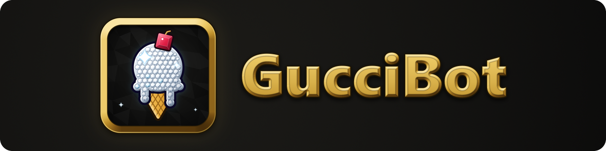

<h1 align="center"></h1>

<!-- GitHub's social preview, the picture a link to this repo shows, is docs/images/github-social-preview.png (1280 x 640). GitHub can't take it from the repo: Nigel uploads it in the repo's Settings > General > Social preview > Edit > Upload an image. -->

> Frame perfect. Ice cold. Brrr Brrr Brrr.

It's Gucci. GucciBot is a Geometry Dash macro bot (a [Geode](https://geode-sdk.org/) mod) that records your inputs frame-perfectly and plays them back exactly, built on top of [Silicate](https://git.puppy.lgbt/silicate/silicate)'s physics engine. It also measures how many frames you had for every click, finds its own way through a level, renders straight to video and trains you on the hard parts. Think of it as a very expensive, very icy ghost of your best run — except the ghost never drops a frame, never has an off day, and definitely never forgets its jewelry. So icy.

**[guccibot.net](https://guccibot.net)** · [Download](https://github.com/Nigelx1/GucciBot/releases/latest) · [Discord](https://discord.gg/m95NUPdbpJ)

## Get it

You need Geometry Dash 2.2081 and Geode 5.10.1 or a later 5.x. One `.geode` file covers Windows, macOS, iOS and Android (32 and 64-bit), and it's about 250 MB, since the renderer, the music and the JMF Trainer's video ride along. The newest release is **2.0.0-beta.5**.

1. Download `nigelx1.guccibot.geode` from the [latest release](https://github.com/Nigelx1/GucciBot/releases/latest).
2. In the game, open Geode's mod list, press the gear for Geode's settings, press **Install From File** and pick the file. (Or put the file in Geode's mods folder yourself: **Open Mods Folder** is in the same place.)
3. Restart the game.
4. Open GucciBot:
   - **Windows:** press **Left Alt**. You can change the key in Settings > Keybinds.
   - **Mac:** press **Option**, or the **GucciBot** logo in a level's pause menu.
   - **iPhone, iPad and Android:** pause a level and press the **GucciBot** logo (the iced cone) in the bottom-right corner of the pause menu.

**Turn off ToastyReplay Lite and Silicate first.** GucciBot can't run live alongside either one (ToastyReplay Lite crashed macro playback; Silicate patches the same spots in the game GucciBot does), so while either is enabled GucciBot stands down and says why. Turn the other one off or uninstall it, restart, and you're in.

Windows is home, and gets the most testing. macOS, iOS and Android are newer: the Android build has run on a phone, the rest has had little testing, and the Pathfinder, rendering and Video Mode still need Windows ([the full list](about.md#platforms)). The Mac build in beta.5 runs on Apple silicon only; Intel Macs come with the next release.

Stuck, or got a question? Ask in [the Discord](https://discord.gg/m95NUPdbpJ). Found a bug? [Open an issue](https://github.com/Nigelx1/GucciBot/issues/new/choose).

## What it does

- **Records and plays back, frame-perfect.** The engine is a port of Silicate's, reconciled function by function. Practice checkpoints are captured whole, so a macro recorded through respawns plays back exactly like one recorded straight through, and a level with random triggers replays the same way every time. Frame advance, backwards stepping, intentional deaths, mirror inputs and RNG lock come with it.
- **GBR6, the hypercompressed macro format.** 2 bytes an input (yBot-sized files for human gameplay), a wave or ship tap stored as one entry, and a steady autoclicker run stored as its pattern instead of click by click.
- **Other bots' macros, in the game.** 27 formats read, among them GDR and GDR2, Silicate .slc, TcBot, ToastyReplay .ttr3, yBot, xdBot, Mega Hack, Echo and GucciBot 1.x's old .brrr, and 21 written back out with **Export as**. Drop one in the replays folder and it converts in one press; the original is kept. The full list is in [about.md](about.md#other-bots-macros).
- **Calculate, the frame-window analyzer.** For every click, how many frames you actually had, measured against the real game engine, not a guess. It runs on anticroom's Silicate analyzer: Time-Based and Recovery Range, windows finer than a single frame, color bands with their own marker shapes, images, pulses and sounds, and an in-level legend. **Windows by hand** lets you type any input's window yourself, and a tight click right after another input also gets Juice's Alignment-Independent count, "my suggestion is x frames", flagged in the Frame Editor. The whole frame-window trend started with NaN GD, and the L* precision number GucciBot puts on a macro comes from his formula, published at [nandl.pages.dev](https://nandl.pages.dev/#formula). He's careful to say frame windows alone don't determine difficulty, and GucciBot says the same. Hitborders were NaN GD's idea too; he isn't involved.
- **Pathfinder: it makes the macro for you.** Open a level with nothing recorded and start it: it plays the level itself until it reaches the end, then saves the run as a macro named after the level. The default engine is Absent's, from Absense, ported in whole: before each input it runs copies of the player ahead through the real level, and it goes back when it hits a dead end. GucciBot's own Classic search is still there too. The AI pathfinder is the big piece still in progress for 2.0, and its first steps are in: **Show the level map** draws every gap, choice and moving part, **Show the planned route** draws its way through the whole level, and **Follow the planned route** has it take that route. Windows only.
- **Trainers.** Nigel's Jupiter My Favourite Trainer, and a second Trainer for any macro you pick: a click bar with your own presses next to the macro's, ghosts of the macro and of your best attempt, segments to name and loop, stats with a death heatmap, synced music, and **Video Mode** to review a run against a video (Windows). Plus **Click Indicators**: the macro's clicks coming at you over the level, with every option of Bogdaner09's free mod, scored Perfect / OK / Miss.
- **Practice tools.** The **Survival Indicator** (does clicking right now survive?), path preview, Prevent Death and Find Best Tick, noclip with an accuracy readout, hitboxes, the macro's path drawn in the level, and an autoclicker with its own hold, release and clicks per hold for each player.
- **Macro tools.** The **Frame Editor** (drag, stretch or shorten every press, with undo), **Check Macro** (lists anything that would desync playback), a diff viewer, trim and merge, TPS changes mid-macro, bot settings presets, and autosave at level end.
- **Rendering** (Windows). Gameplay straight to a video file, no recorder needed: a hardware encoder picked for your graphics card, anticroom's intro card, four separate audio tracks if you want them, the frame-window markers and cues baked in, fades at both ends, and presets (**Showcase** sets up 8K60 lossless in one press). It runs on FFmpeg 8.0.1 (GPL v3), bundled in the package; where those DLLs come from and their source: [guccibot-build-files](https://github.com/Nigelx1/guccibot-build-files).
- **Auto safe mode**, on by default: while a cheat is on (a macro playing, noclip, speedhack, Click Indicators and the rest), an attempt doesn't count. No completion, no new best, nothing sent to the servers. A **setup check** warns about the settings that break the engine, and the **Disable bot** switch takes GucciBot out of the game without a restart.
- **And the rest.** Click sounds (the built-in Clickbot pack or your own), a HUD with CPS, 19 hotkeys, **Compact Mode** to keep the bot at hand while you play, editor tools, an update check, and **Assistant Access**, an optional local server an AI assistant on your computer can read and drive the bot through (off by default).
- **Themes.** 20 built-in ones, each saving macros under its own extension, a full editor for your own, and BIG BRRRR. The roster is [below](#themes).

Every feature and setting is in [about.md](about.md), the page Geode shows for the mod, and on [guccibot.net](https://guccibot.net).

### Coming in the next release

On `master` now, in the package every push builds. Some of it is still waiting on its in-game test; each commit message says.

- Four more themes: **RondoBot**, **SolarBot**, **JupiterBot** and **GBot**, a disguise.
- **Legit only** (Hacks > Gameplay): one switch that turns off everything that counts as a cheat and gives it all back when you turn it off. While it's on, no macro plays, so turn it off to render one.
- Safe mode's cheat list now follows the Demonlist's rules for allowed mods: recording a macro, hitboxes shown while you play, Layout mode, No Mirror while it applies, the Survival Indicator, the HUD's Touching orbs and Time warp, a trainer's click bar or Video Mode over its own level, and the Pathfinder's level map, planned route and next gate count as cheats. The cheat mark shows on the end screen too, and renders never show it. In plain play, with no macro recording or playing, GD keeps its own random.
- GucciBot stands down while anticroom's Antic's Counter is enabled, as it does for ToastyReplay Lite and Silicate.
- Calculate's **Default Look** (drawn like the counter in NaN GD's videos), your own text in the level over any input, presets (Balanced, Accuracy, Absolute), **Max window** and **Ship steering** (based on anticroom's Antic's Counter, on by default: a ship timing that kills you still counts if taps a person could make keep you alive). It also measures closer to anticroom's original: its tests end on the same tick his do, a test that starts just before a slope gets the slope's launch, as real play does, sub-tick tests move the next inputs along first, and Juice's suggestion pass finishes sooner, often much sooner on long levels.
- The Pathfinder page gets an **Engine** choice. **Search (old)**, the default, is the pathfinder as it is now, stronger, with **Route drives** (experimental), a much faster simulation of busy levels, **Exact start flags**, and every search cold unless **Remember solutions** is on. **AI** is still being built: no trained network ships yet, so with it picked, Start stays grayed out.
- **Record from where a macro is**: switch Mode to Record while a macro plays and it carries on from there, with the rest cut, so a macro can be added to or its end redone.
- **Hitborders**: every hitbox grown by yours, so you're a point and the gaps drawn are the room your center really has, from the game's own collision rules, with a hotkey of its own. They look like NaN GD's: red, blue and green at half fill, used orbs, pads and portals still drawn (or hidden, with a switch), a thin yellow path, and the level darkened under the borders so they stand out.
- The setup check names a second GucciBot file in the mods folder, which Geode lists as invalid, and says which one to delete.
- **Block inputs during playback** (on by default, as in Silicate), an intro card with every line yours to edit, BrrrBot's snow, Intel Macs, BIG BRRRR switching to the new theme's song when you pick one mid-drop, and fixes: a release and a press in one tick are recorded once (beta.5 could record extra presses there), reopening a level with random triggers no longer crashes, and the Safe mode switch works.

## Themes

Pick one on the **Themes** page, or build your own there: **New custom theme** opens a full editor (colors, identity, quotes, your own BIG BRRRR track) for exactly this occasion.

<details>
<summary>The full roster: 20 themes, four more coming</summary>

| Theme | Extension | Colors |
|---|---|---|
| GucciBot | `.brrr` | Gold + Black |
| ToosiiBot (LSU / Syracuse / Sac State) | `.toosii` | Purple+Gold / Orange+Navy / Green+Gold |
| JaBot | `.ja` | Navy + Light Blue |
| GiddeyBot | `.giddey` | Thunder Blue + Orange |
| BamBot | `.bam` | Heat Black + Red |
| SexyyBot | `.sexyy` | Hot Pink + Purple |
| JuiceBot | `.juice` | Coral + Teal |
| ButlerBot | `.butler` | Bulls Red + Black |
| SaweetieBot | `.saweetie` | Hot Pink + Plum |
| MaybachBot | `.maybach` | Platinum + Black |
| RomoBot | `.romo` | Cowboys Navy + Silver |
| GrizzleyBot | `.grizzley` | Charcoal + True Red |
| **Red Kingdom** | `.redkingdom` | Blood red that *pulses*, because a static color wasn't intense enough |
| LemonadeBot | `.lemonade` | Bright Yellow + Warm Black |
| BrrrBot | `.icebrrr` | Icy Blue + Navy, with live snow falling behind the panel from the next release |
| WakaBot | `.waka` | Grove Green + Black |
| YoungstaBot | `.youngsta` | Black + Red (223) |
| KnockerzBot | `.knockerz` | Teal + Black |
| RondoBot *(next release)* | `.rondo` | Celtics Green + White, on the TD Garden's parquet with a gold trim |
| SolarBot *(next release)* | `.solar` | Sun Yellow + Deep Orange, with Janet (Solar Flare's sun) in the corner of its dark sky and the planets riding their orbits around her |
| JupiterBot *(next release)* | `.jupiter` | JMF Yellow + Night Blue: the JMF Trainer's star chart at night, moon dial and skyline, on every page |
| GBot *(next release)* | `.gbot` | Charcoal + Steel Blue, to hide true greatness from da opps |
| *Yours* | — | Whatever you want. That's the point. |

SolarBot, JupiterBot and GBot have no BIG BRRRR; it comes back with any other theme, as you left it. GBot moves in silence: the menu answers to GBot, the Themes picker ducks into Settings, and the JMF Trainer and Credits pages, the BIG BRRRR card and the macro list's theme tags lie low until you switch back. New macros save as `.gbot`. Geode's mod list still knows the real name, so don't let anyone scroll that far.

GucciBot's own color is gold, for the record. Yellow everything this time, you know what I'm talking about? Yellow rims. Yellow big booty yellowbones, ha. Yellow Lambs, yellow MPs, yellow watch. Yellow charm ring, chain. Yellow living room set.

Also in Settings: **BIG BRRRR**, a core feature of this mod, with **Shake** and **Flicker** to make the whole menu react to the track's actual bass in real time. You'll know it when you feel it.

</details>

## Status

2.0 is in beta. **2.0.0-beta.5** is the newest release, and the work since then lands on `master`, where every push builds the full package. What's left before 2.0, mostly the AI pathfinder and a test of every feature in the game, is ticked off in [docs/ROAD_TO_2_0.md](docs/ROAD_TO_2_0.md), and anything still waiting on its in-game test says so in its commit message.

## Help and contact

How to use it, setting it up, or anything that isn't a bug: ask in the Discord server, **[Nigel's Neighborhood](https://discord.gg/m95NUPdbpJ)**.

Made by one person, so all of these reach the same human.

| | |
|---|---|
| **Email** | [nigel@guccibot.net](mailto:nigel@guccibot.net) |
| **Discord server** | [Nigel's Neighborhood](https://discord.gg/m95NUPdbpJ) |
| **Discord** | `jimmybutlerfan` |
| **Phone** | 555-ICE-COLD<sup>✱</sup> |

**Found a bug? Open an [issue](https://github.com/Nigelx1/GucciBot/issues) rather than messaging it.** Not out of formality — a crash log posted in a thread can actually be symbolized and traced to the exact line that caused it, and it stays findable for whoever hits the same thing next. Attach the crash report Geode hands you and say what you were doing. That has been enough to fix nearly every real bug this mod has had, including a use-after-free nobody could reproduce.

There's a [contact page](https://guccibot.net/contact/) on the site with the same details.

<sub>✱ Not a real number. There has never been a 555 area code, which is doing all of the work here.</sub>

## Credits

<details>
<summary>Nigelx1, Claude, Juice, anticroom, dihmaster500, DashBlaze, Isaiah, Absent, Bogdaner09, GWDdoS, ToastexGD, C0nscious and Gucci Mane</summary>

- **Nigelx1** — creator and owner of GucciBot. Every idea, every theme, every decision is his call, down to the taste that keeps this from being a folder full of ternary chains.
- **Claude** (Anthropic) — wrote essentially the entire codebase across every session of this project, including this README. Not a euphemism, not "AI-assisted," just the actual author of the code — Nigel wants that said plainly.
- **Juice** — designed the frame-window algorithm GucciBot ran on through 1.7, and the marker shapes in 1.8; his Alignment-Independent method is back as Calculate's suggestion for suspicious clicks. Lead co-tester, professional bug-finder.
- **anticroom** — 1.8's Calculate *is* his analyzer. He rewrote the frame-window system for Silicate, sent the source over, and it was ported in near-verbatim to replace GucciBot's own — the headline feature of 1.8 is his work. Sub-tick CBF recording and the render intro card in 2.alpha.3 are his too. Before that he sent GucciBot's first outside pull request, a real 7-fix accuracy pass. Also one of ToastyReplay's own devs.
- **dihmaster500** — tester. Asked for auto safe mode with its cheat indicator, and for the Disable bot switch, then tested safe mode hard enough to catch it breaking start positions before anyone else hit it.
- **DashBlaze** — promo help.
- **Isaiah** — promo help.
- **Absent** — Absense, another bot built on Silicate. Pathfinder's default engine is his: Absense's pathfinder, with its look-ahead and its model of the level, ported in whole in 2.0.0-beta.2. The in-game assistant server, Check Macro, Replace All, the respawn timer and the black orb autoclicker loop came from reading his source; that code is our own, the ideas are his.
- **Bogdaner09** — when a paid click-indicator mod turned out to be an exit scam, he's the one who started making the same thing free and open source ([github.com/Bogdaner09/mod](https://github.com/Bogdaner09/mod)). Nigel found it, and GucciBot's Click Indicators are built around his. Vibecoded by his own admission, so credit's probably owed elsewhere too.
- **GWDdoS** — optimization help, and pushed for a real codebase cleanup (feature-folder reorg, a proper `.clang-format`, namespacing everything outside Geode's own hook classes) and was right about all of it. Also built Astral.
- **ToastexGD** — built ToastyReplay, the project this actually started as, and the reason there is a GucciBot at all. His renderer and FFmpeg pipeline carried the mod for most of its life. Rendering now runs on Silicate's renderer instead; his was retired in 2.0 after being left unreachable by an earlier port, and the history is his either way.
- **C0nscious** — implemented NaN GD's L* precision formula in C++ as [Frame Window Counter](https://github.com/hyper-5/frame-window-counter) (MIT), a mod named after NaN's video series. That implementation is the code that reached GucciBot, via anticroom.
- **Gucci Mane** — he's the truth. Brrr.

</details>

## License

GucciBot is free software under the **GNU General Public License v3.0** — see [LICENSE](LICENSE).

It's built on [Silicate](https://git.puppy.lgbt/silicate/silicate) by peony, which is GPL-3.0, and includes anticroom's GPL-3.0 work from his Silicate fork; C0nscious's Frame Window Counter code is MIT, and the converter's TcBot reader follows [tcm-rs](https://github.com/tcbot-gd/tcm-rs) by tcbot.pro, also MIT; both are compatible. You're free to use it, study it, share it and change it. Anything you distribute that's built from it has to stay open source under the same license.

**ToastyReplay.** GucciBot started out as a fork of [ToastyReplay](https://github.com/ToastexGD/ToastyReplay) by ToastexGD, and ToastyReplay's source code was used in GucciBot up to and including 2.0.0-beta.2. That code was removed on 2026-10-02 (commit `385a5f7`); versions after 2.0.0-beta.2 contain none of it.

## Building it

- Target: Geometry Dash 2.2081. Every push to `master` builds Windows, macOS, iOS and Android on GitHub Actions (`.github/workflows/multi-platform.yml`) into **one `.geode` with everything in it**: all five platforms and every resource. That file *is* the release: one universal build per commit.
- The renderer's FFmpeg DLLs are too big for this repo (one is over GitHub's 100 MB limit), so they live in [guccibot-build-files](https://github.com/Nigelx1/guccibot-build-files); the build downloads them and checks their SHA-256 before packing them in.
- `.\install_ci_build.bat` installs GitHub's build of the commit you have checked out (waiting if it's still building) and keeps a copy in `build\ci\`.
- Requires the [Geode SDK](https://geode-sdk.org/) and its usual toolchain (CMake, Ninja, MSVC).
- A quick local Windows build:
  ```
  .\build_win.bat
  ```
  and the offline tests: `.\run_tests.bat`.
- Every build bumps `GB_BUILD_LABEL` in `src/core/GucciBot.hpp` — check it before assuming which binary is actually running. This project got burned by testing a stale build exactly once, and once was enough. Trap or die, basically.
- A clone is about 260 MB: the BIG BRRRR tracks and the JMF Trainer's video live in the repo. The plans and audits behind the work are in [docs/](docs).

---

*Frame perfect. Ice cold. Brrr.*
