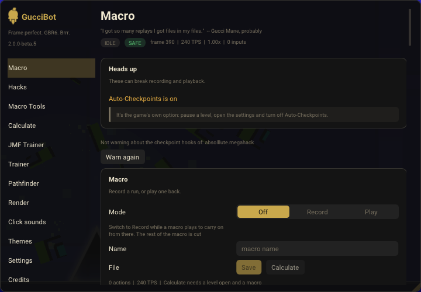
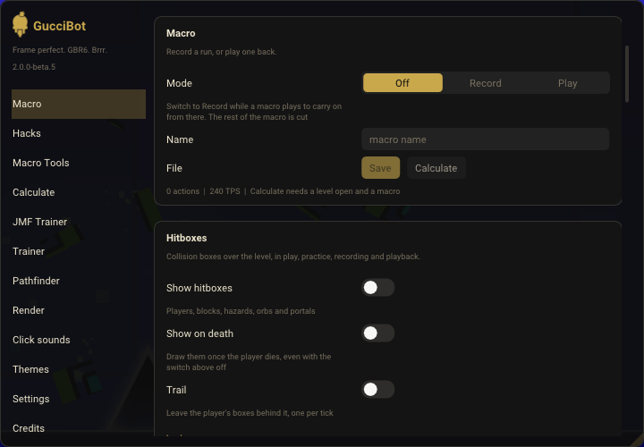
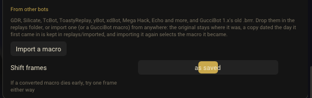
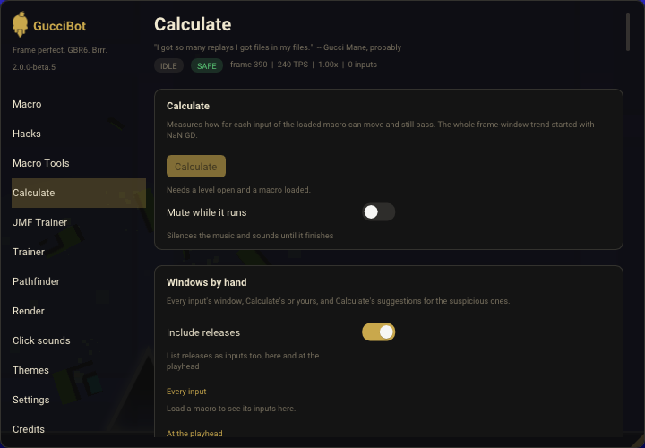
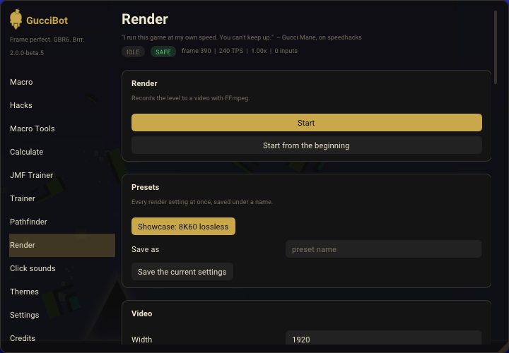
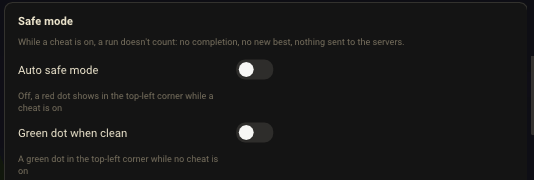

# How to use GucciBot

A quick guide: install it, open it, record your first macro, and fix the usual problems.
Stuck anywhere? Ask in [the Discord](https://discord.gg/m95NUPdbpJ).

This guide is written for 2.0. A few things in it are newer than 2.0.0-beta.5. Those say **(new in 2.0)**.

---

## 1. Install

You need **Geometry Dash 2.2081** and **[Geode](https://geode-sdk.org/) 5.10.1 or a later 5.x**.
There is **one file** for every platform: `nigelx1.guccibot.geode` (over 200 MB, because the renderer, the music and the JMF Trainer's video come with it).

### Every platform

1. Install Geode first, using the steps on [geode-sdk.org](https://geode-sdk.org/) for your platform.
2. Download `nigelx1.guccibot.geode` from the [latest release](https://github.com/Nigelx1/GucciBot/releases/latest).
3. Open the game, then open Geode's mod list.
4. Press the gear for Geode's settings, then **Install From File**, and pick the file.
   Or put the file in Geode's mods folder yourself: **Open Mods Folder** is in the same place.
5. Restart the game.

### Where the mods folder is

The **Open Mods Folder** button always finds it. By hand:

| Platform | Mods folder |
|---|---|
| **Windows** (Steam) | In Steam, right-click Geometry Dash > Manage > Browse local files. Then open `geode\mods`. |
| **Mac** | `~/Library/Application Support/GeometryDash/geode/mods` |
| **Android** | `Android/media/com.geode.launcher/game/geode/mods` (Geode's launcher) |
| **iPhone / iPad** | Use **Install From File**; the folder depends on how Geode is installed. |

### How well each platform is tested

- **Windows** is home and gets the most testing.
- **Android** has run on a phone.
- **Mac, iPhone and iPad** have had little testing.
- beta.5's Mac build runs on Apple silicon only. Intel Macs come with the next release.
- The **Pathfinder**, **Render** and **Video Mode** still need Windows.

---

## 2. Open the menu

| Platform | How |
|---|---|
| **Windows** | Press **Left Alt**. |
| **Mac** | Press **Option**, or pause a level and press the **GucciBot** button. |
| **iPhone, iPad, Android** | Pause a level and press the **GucciBot** button in the bottom-right corner of the pause menu. |

- The pause-menu button shows the GucciBot logo, an iced cone **(new in 2.0)**. In beta.5 it's a button with the word GucciBot.
- To change the key on Windows: **Settings > Keybinds > Open the menu**. Click the key, then press the new one. Right-click unbinds it.
- The pages are down the left side: **Macro, Hacks, Macro Tools, Calculate, JMF Trainer, Trainer, Pathfinder, Render, Click sounds, Themes, Settings, Credits**.

*The menu, open on the Macro page. The pages are down the left side.*

---

## 3. Your first macro

A macro is a recording of your inputs, tick by tick. GucciBot plays it back exactly.

### Record

1. Open a level.
2. Open the menu and go to the **Macro** page.
3. In the **Macro** card, set **Mode** to **Record**.
4. Restart the level and play it.
5. When you're done, type a name in **Name** and press **Save**.

Practice mode works too. Checkpoints are captured whole, so a macro recorded through respawns plays back like one recorded straight through.

**Autosave:** the **Saving** card on the same page has **Autosave at the level's end** and **Autosave on a timer**.

### Play

1. On the **Macro** page, find your macro in **Saved macros** and click its name to load it.
2. Set **Mode** to **Play**.
3. Restart the level. The macro plays.

- **Block inputs during playback** (new in 2.0, on by default), in the **Recording and playback** card, means only the macro presses buttons.
- **Check macro** (in **Saved macros**) lists anything that would make playback go wrong.
- To edit a macro click by click: **Macro Tools > Frame Editor**. Edits stay in memory until you press **Save** on the Macro page.

*The Macro card: set Mode, type a Name, press Save.*

---

## 4. Load other bots' macros

GucciBot reads 27 formats: GDR and GDR2, Silicate `.slc`, TcBot, ToastyReplay `.ttr3`, yBot, xdBot, Mega Hack, Echo, GucciBot 1.x's old `.brrr`, and more. The full list is in [about.md](../about.md#other-bots-macros).

Go to **Macro > Saved macros**, to the part called **From other bots**. Then either:

**Import one file from anywhere**
1. Press **Import a macro** and pick the file.
2. GucciBot converts it right away and loads it. Play it like any other macro.

The file you picked stays where it was. A dated copy is kept in `replays/imported`.

**Or convert files in the replays folder**
1. Press **Open folder** (at the top of **Saved macros**) and copy the files into the replays folder that opens.
2. Each file shows under **From other bots** with its format and a **Convert** button. (If one doesn't show, press **Refresh**.)
3. Press **Convert** (or **Convert all**). The converted macro shows in the list.

After converting, the original moves to `replays/converted`, so it isn't offered again. An old `.brrr` is renamed to `.brrr.1x` instead.

- If a converted macro dies early, set **Shift frames** one frame either way, and convert it again.

*Saved macros > From other bots, with Import a macro and Shift frames.*

---

## 5. Calculate (frame windows)

Calculate measures, for every input in the loaded macro, how many frames you had: how far the click could move and still pass. It measures against the real game engine, not a guess. It runs on anticroom's Silicate analyzer. The whole frame-window trend started with NaN GD.

1. Load a macro and open its level.
2. Go to the **Calculate** page and press **Calculate** (or press **Calculate** on the Macro page).
3. Wait for the bar to finish. Markers show over the level, colored by window size.

- **Copy info** copies the precision and window breakdown, in the format NaN uses in video descriptions.
- **Overlay** and **Bands** change how the markers look. **Precision (L\*)** shows the L* number (NaN GD's formula).
- **Windows by hand** lets you type any input's window yourself. At the top of its **Every input** table, **Set every window to [x] frames** gives every input the same window in one press **(new in 2.0)**. It asks first if that would replace any window. **Clear** on a row puts Calculate's own count back.
- Calculate silences the game while it runs and gives your volumes back when it finishes. There's no switch for this.
- Mods that step frames themselves throw the numbers off. Calculate says so when it finds one.

A Calculate run counts as a cheat (see section 7). Frame windows alone don't decide how hard a level is.

*The Calculate card. The button lights up once a level is open and a macro is loaded. This picture is from beta.5: the Mute while it runs switch under the button is gone in 2.0.*

---

## 6. Render a video (Windows only for now)

Render records gameplay straight to a video file. No screen recorder needed. It loads FFmpeg from Windows DLLs, so it doesn't run on Mac or phones yet.

1. Load a macro and set **Mode** to **Play** (or just play the level yourself).
2. Open the level, then go to the **Render** page.
3. Press **Start from the beginning** (or **Start** to begin where you are).
   Not in a level yet? **Render the next level I open** waits for one.
4. Press **Stop** when you want it to end.

- **Output > Folder** picks where the video goes. Blank uses the default folder.
- Presets: **Showcase: 8K60 lossless** sets everything up in one press.
- The **Video**, **Audio**, **Timing** and **Intro card** cards hold the rest.
- If it says **FFmpeg isn't loaded**, the start buttons are grayed out **(new in 2.0)**. Restart the game: it puts the files back. **Open the FFmpeg folder** shows where they belong.

*The Render card in a level, with Start and Start from the beginning, and the presets below it.*

---

## 7. Safe mode and Legit only

**Auto safe mode** is on by default. While a cheat is on, a run doesn't count: no completion, no new best, nothing sent to the servers.

- Cheats include a macro playing or recording, noclip, speedhack, hitboxes while you play, Calculate, the Pathfinder and Click Indicators.
- **Settings > Safe mode** has **Auto safe mode** and **Green dot when clean** (a green dot in the top-left corner while no cheat is on).
- If you turn **Auto safe mode** off, a **red dot** shows in the top-left corner while a cheat is on (or was, this attempt). The run counts then, and the dot shows it was cheated.
- The level's end screen shows the red dot whenever a cheat was on in that attempt, whatever safe mode did **(new in 2.0)**.
- **Your own editor levels (new in 2.0):** a run with a cheat or the bot on (recording too) never verifies the level, even with **Auto safe mode** off. The end screen says so instead of "Level Verified!". A clean run with safe mode off still verifies.
- **Hacks > Gameplay > Safe mode** makes no run count at all, cheat or not.

**Legit only (new in 2.0):** **Hacks > Gameplay > Legit only** turns off everything that counts as a cheat, at once, and keeps it off. Macros can't play or record while it's on. Turn it off and your settings come back as they were.

**Take GucciBot out of the game:** **Settings >** the first card, switch **GucciBot** off. The game runs as if GucciBot weren't installed, with no restart. Switch it back on the same way.

*Settings > Safe mode. Auto safe mode is on by default; it's switched off in this picture.*

---

## 8. The setup check

Some settings and mods break recording and playback. GucciBot checks for them each launch.

- If it finds one, a **Heads Up** popup lists each problem and how to fix it.
- When you start recording or playing, you get a short **Heads up** note. The full list is in the **Heads up** card on the **Macro** page.

What it looks for:

- The game's own **Auto-Checkpoints** option (pause a level, open the settings, turn it off).
- **Mega Hack's Practice Bug Fix**, or another mod that hooks the game's checkpoints. GucciBot has its own practice fix, and two of them fight. If a mod is named that has no practice fix, press **It's fine**.
- **Frame Extrapolation** in Mega Hack or QOLMod.
- **Another bot running.** Two bots fight over your inputs.
- **A second GucciBot file in the mods folder (new in 2.0).** It says which one to delete.

---

## 9. Troubleshooting

### "Unable to read entry (code -3)"
This is Geode saying it can't unpack the file. Usually the download is damaged (it didn't finish, or got cut off).
1. Delete `nigelx1.guccibot.geode` from the mods folder.
2. Download it again from the [release page](https://github.com/Nigelx1/GucciBot/releases/latest). It should be over 200 MB.
3. Install it again and restart.

### "GucciBot Is Standing Down"
GucciBot can't run live alongside **ToastyReplay Lite**, **Silicate** or **Antic's Counter** (Antic's Counter is new in 2.0). While one is enabled, GucciBot leaves the game alone for that launch and says which one.
1. Open Geode's mod list.
2. Turn the other mod off (or uninstall it).
3. Restart the game.

### Geode lists a second GucciBot as invalid
Geode loads one copy of a mod and marks any other copy invalid. This happens when an old file is still in the mods folder.
1. Open the mods folder.
2. Keep the newest GucciBot file and delete the rest.
3. Restart the game.

In 2.0 the setup check names the file for you.

### Nothing happens when I press the key
- Check **Settings > Keybinds > Open the menu**.
- On a Mac, use the **GucciBot** button in the pause menu.
- On iPhone and iPad no key reaches GucciBot: always use the pause-menu button.
- If the stand-down popup showed at launch, see above.

### Where the logs are
Bug reports go much faster with these.
- **Geode's log:** the `geode/logs` folder inside the game's folder (next to `geode/mods`).
- **Crash reports:** Geode shows a crash report after a crash. Attach it.
- **GucciBot's own logs (Windows):** `%LOCALAPPDATA%\GeometryDash\geode\mods\nigelx1.guccibot\` (files like `guccibot_fw.log`). Each launch starts them fresh and keeps the launch before as `.old.log` **(new in 2.0)**. Your macros are in the `replays` folder there.
- **Settings > Diagnostics (new in 2.0)** shows what GucciBot's startup self-check found: a pass or fail mark, what each failed check found, and the full list.

---

## 10. Where to ask

- **Questions and setup help:** [Nigel's Neighborhood on Discord](https://discord.gg/m95NUPdbpJ).
- **Bugs:** [open a GitHub issue](https://github.com/Nigelx1/GucciBot/issues/new/choose). Say what you were doing, and attach Geode's crash report or log.
- Every feature and setting is listed in [about.md](../about.md) and on [guccibot.net](https://guccibot.net).

GucciBot is made by Nigelx1, and Claude (Anthropic) wrote essentially all of its code. The full credits are on the in-game **Credits** page, in [README.md](../README.md#credits) and in [about.md](../about.md).
