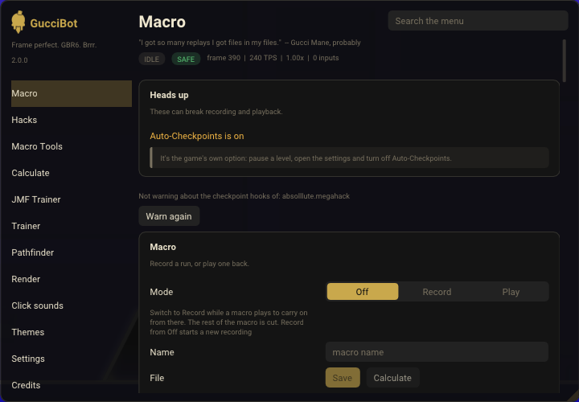
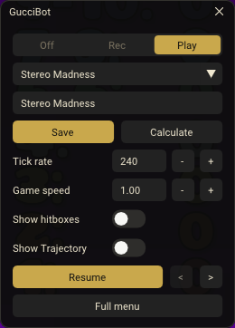
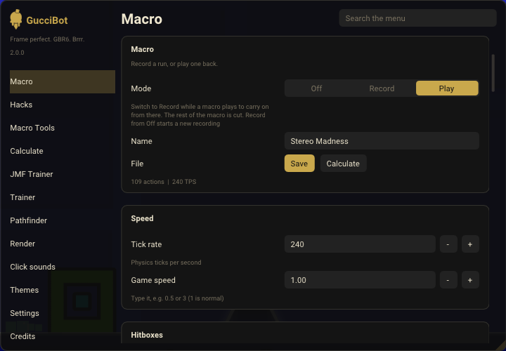
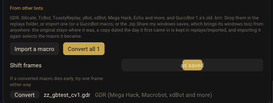
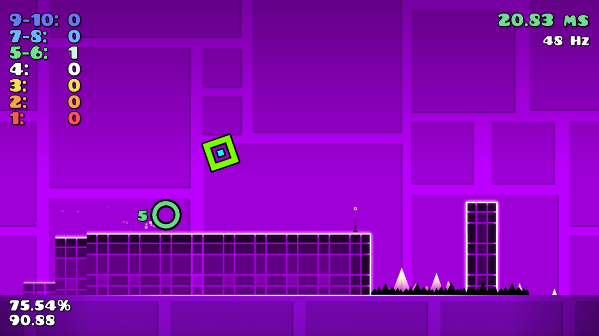
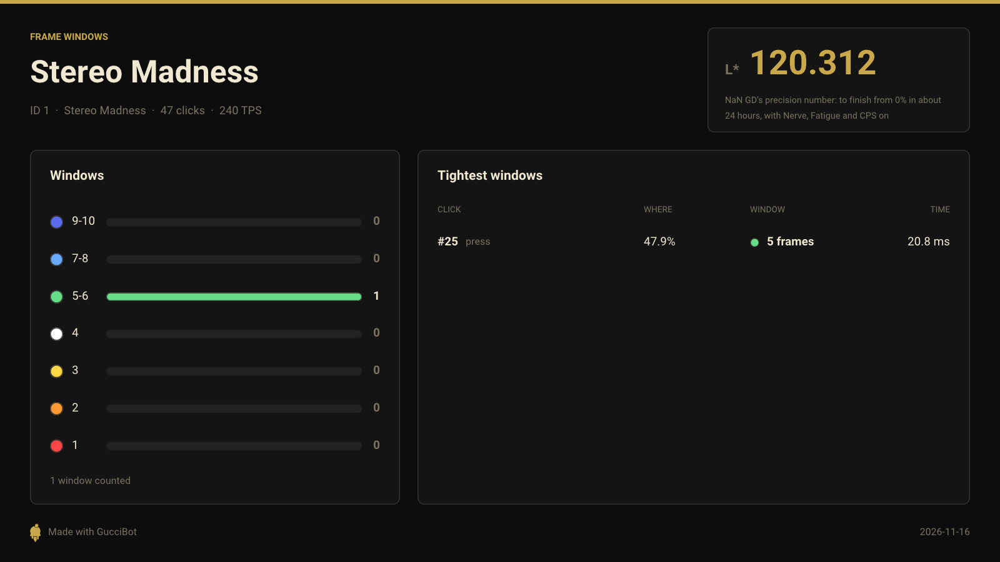
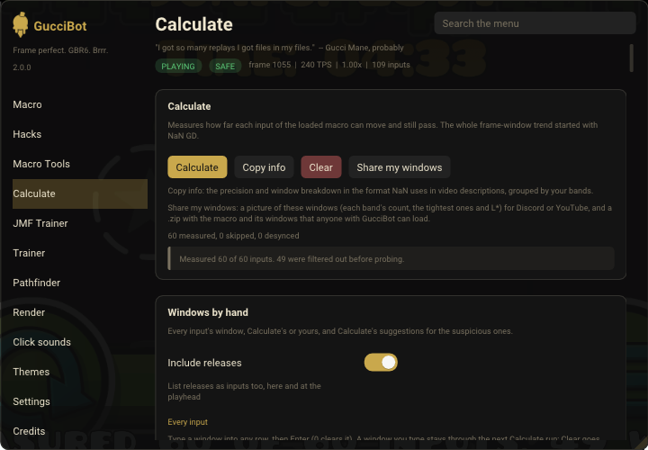
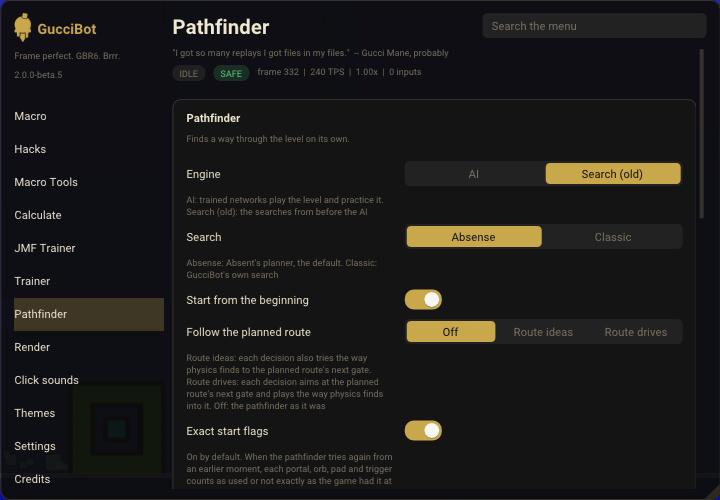
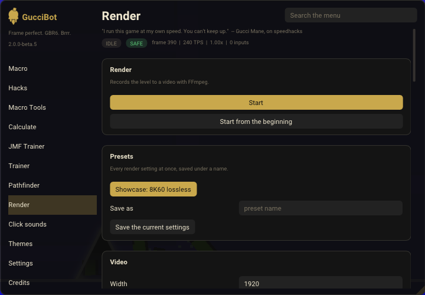
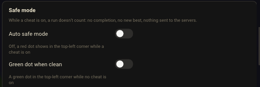

# How to use GucciBot

A quick guide: install it, open it, record and replay a macro, measure your frame windows, let the Pathfinder play, render a video, and fix the usual problems.
Stuck anywhere? Ask in [the Discord](https://discord.gg/m95NUPdbpJ).

This guide is for GucciBot 2.0. Things that are new since 2.0.0-beta.5 say **(new in 2.0)**.

**Contents:**
[Install](#1-install) ·
[Open the menu](#2-open-the-menu) ·
[Record a macro](#3-record-and-save-a-macro) ·
[Replay it](#4-replay-a-macro) ·
[Other bots' macros](#5-load-other-bots-macros) ·
[Calculate](#6-calculate-frame-windows) ·
[Pathfinder](#7-let-the-pathfinder-play-a-level) ·
[Render](#8-render-a-video) ·
[Themes](#9-try-a-theme) ·
[Handy tools](#10-handy-tools-while-you-practice) ·
[Safe mode](#11-safe-mode-legit-only-and-switching-guccibot-off) ·
[Setup check](#12-the-setup-check) ·
[Troubleshooting](#13-troubleshooting) ·
[Where to ask](#14-where-to-ask)

---

## 1. Install

You need **Geometry Dash 2.2081** and **[Geode](https://geode-sdk.org/) 5.10.1 or a later 5.x**.
There is **one file** for every platform: `nigelx1.guccibot.geode` (over 200 MB, because the renderer, the music and the JMF Trainer's video come with it).

### Every platform

1. Install Geode first, using the steps on [geode-sdk.org](https://geode-sdk.org/) for your platform.
2. Download `nigelx1.guccibot.geode` from the [latest release](https://github.com/Nigelx1/GucciBot/releases/latest).
3. Open the game, then open Geode's mod list.
4. Press the gear for Geode's settings, then **Install From File**, and pick the file.
   Or put the file in Geode's mods folder yourself: **Open Mods Folder** is in the same place.
5. Restart the game.

### Where the mods folder is

The **Open Mods Folder** button always finds it. By hand:

| Platform | Mods folder |
|---|---|
| **Windows** (Steam) | In Steam, right-click Geometry Dash > Manage > Browse local files. Then open `geode\mods`. |
| **Mac** (Steam) | Inside the game's app: `~/Library/Application Support/Steam/steamapps/common/Geometry Dash/Geometry Dash.app/Contents/geode/mods` (right-click the app > Show Package Contents). |
| **Android** | `Android/media/com.geode.launcher/game/geode/mods` (Geode's launcher) |
| **iPhone / iPad** | Use **Install From File**; the folder depends on how Geode is installed. |

### How well each platform is tested

- **Windows** is home and gets the most testing.
- **Android** has run on a phone.
- **Mac, iPhone and iPad** have had little testing. The Mac build runs on Apple silicon and on Intel Macs **(new in 2.0)**; nobody has tried it on an Intel Mac yet.
- **Rendering and Video Mode** work on Windows and Mac **(Mac is new in 2.0, and not tried on a Mac yet)**. They don't work on phones yet.
- **The Pathfinder** runs everywhere **(new in 2.0)**, but it's at its best on Windows. Off Windows it can't see what move and rotate triggers will do next, so levels that use them fail more often. The page says so. It hasn't been tried on a Mac or a phone yet.
- **Still Windows only:** tick rates under 162 TPS, High TPS precision, and the Pathfinder's **Rotate triggers (experimental)** switch.

---

## 2. Open the menu

| Platform | How |
|---|---|
| **Windows** | Press **Left Alt**. |
| **Mac** | Press **Option**, or pause a level and press the **GucciBot** button. |
| **iPhone, iPad, Android** | Pause a level and press the **GucciBot** button in the bottom-right corner of the pause menu. |

- The pause-menu button shows the GucciBot logo, an iced cone **(new in 2.0)**.
- To change the key on Windows or Mac: **Settings > Keybinds > Open the menu**. Click the key, then press the new one. Right-click unbinds it.
- The pages are down the left side: **Macro, Hacks, Macro Tools, Calculate, JMF Trainer, Trainer, Pathfinder, Render, Click sounds, Themes, Settings, Credits**.

*The menu, open on the Macro page. The pages are down the left side, and the search box is at the top right.*

### Search the menu (new in 2.0)

Every page has a **Search the menu** box at the end of its title line.

1. Click the box (or press **Ctrl+F** on a keyboard).
2. Type what you want, like `noclip`, `hitboxes` or a theme's name. Old names work too, like `path preview`.
3. Click a result (or press **Enter** for the first one). The menu jumps to that setting and outlines it for a moment.

**Escape** clears the box. While you type in it, your keys don't reach the game or your hotkeys.

### Two ways to lay out the menu (new in 2.0)

**Settings > Look > Layout** has two choices:

- **Pages** (the default): one page at a time, as in the picture above.
- **Windows**: a bar across the top (the search box, a button for each page, **Pages** and **Close**), and every card of the pages you pick in a window of its own. Drag a window by its title bar, and collapse it with its arrow. Where you put them is remembered. **Tile them again** puts them back in neat columns.

Phones always use Pages, because the windows need a mouse.

### Compact Mode

Want a small window instead of the whole menu? Switch on **Settings > Look > Compact mode** (or bind a key to **Compact mode** in Settings > Keybinds).

Compact Mode has the things you use most:

- **Mode** (Off, Rec, Play) and **Load a saved macro**
- the macro's **Name**, **Save** and **Calculate**
- **Tick rate** and **Game speed**
- **Show hitboxes** and **Show Trajectory**
- **Pause** (or **Resume**) and the **<** and **>** step buttons
- **Full menu**, to go back to the whole menu

Everything in that list except Mode, Name and Save is **new in 2.0**. Compact Mode has no search box.

*Compact Mode: the quick controls in one small window.*

---

## 3. Record and save a macro

A macro is a recording of your inputs, tick by tick. GucciBot plays it back exactly.

1. Open a level.
2. Open the menu and go to the **Macro** page.
3. In the **Macro** card, set **Mode** to **Record**.
4. Close the menu, restart the level and play it.
5. When you're done, open the menu, type a name in **Name** and press **Save**. A note under the buttons says **Saved**, or why it couldn't save.

- A name can't have `\ / : * ? " < > |` in it.
- **Practice mode works too.** Checkpoints are saved whole, so a macro recorded through respawns plays back like one recorded straight through.
- **Fix a mistake without starting over (new in 2.0):** while the macro plays, switch **Mode** to **Record** at the spot you want to change. Recording carries on from there, and the rest of the macro is cut. **Save** then saves over that macro, as it does after any change to a macro you loaded.
- **When the name is taken (new in 2.0):** if another macro already has the name in **Name** (say you recorded from **Off** and the last macro's name was still there), **Save** asks first: **Replace** it (it's backed up first if that's on), **Save as "name 2"** to keep both, or **Cancel**. An autosave can't ask, so it keeps both: it saves as "name 2" and says so.
- **Autosave:** the **Saving** card on the same page has **Autosave at the level's end** and **Autosave on a timer**. **Back up a macro before overwriting it** is on by default.
- Your macros are saved with your theme's file ending (`.brrr` for the GucciBot theme). The **Saved macros** list shows which theme each one was saved under.

*The Macro card: set Mode, type a Name, press Save.*

---

## 4. Replay a macro

1. Open the level the macro was made on.
2. On the **Macro** page, find your macro in **Saved macros** and click its name. That loads it and sets **Mode** to **Play**. (The **search** box above the list filters it.)
3. Restart the level. The macro plays.

- **Block inputs during playback** (in the **Recording and playback** card, on by default) means only the macro presses buttons. Switch it off if you want your own clicks to reach the game too.
- **Check macro** (in **Saved macros**) lists anything that would make playback go wrong.
- The **...** button on a macro's row has **Load**, **Calculate**, **Rename**, **Delete** and more.
- To edit a macro click by click: **Macro Tools > Frame Editor**. Edits stay in memory until you press **Save** on the Macro page.
- A hotkey can start and stop playback: **Settings > Keybinds > Start / stop playback**.

---

## 5. Load other bots' macros

GucciBot reads 27 formats: GDR and GDR2, Silicate `.slc`, TcBot, ToastyReplay `.ttr3`, yBot, xdBot, Mega Hack, Echo, GucciBot 1.x's old `.brrr`, and more. The full list is in [about.md](../about.md#other-bots-macros).

Go to **Macro > Saved macros**, to the part called **From other bots**. Then either:

**Import one file from anywhere**
1. Press **Import a macro** and pick the file.
2. GucciBot converts it right away and loads it. Play it like any other macro.

The file you picked stays where it was. A dated copy is kept in `replays/imported`. **Import a macro** also takes GucciBot macros, and the `.zip` that **Share my windows** saves (see section 6) **(new in 2.0)**.

**Or convert files in the replays folder**
1. Press **Open folder** (at the top of **Saved macros**) and copy the files into the replays folder that opens.
2. Each file shows under **From other bots** with its format and a **Convert** button. (If one doesn't show, press **Refresh**.)
3. Press **Convert** (or **Convert all**). The converted macro shows in the list.

After converting, the original moves to `replays/converted`, so it isn't offered again. An old `.brrr` is renamed to `.brrr.1x` instead.

- If a converted macro dies early, set **Shift frames** one frame either way, and convert it again.

*Saved macros > From other bots, with Import a macro, Convert and Shift frames.*

---

## 6. Calculate (frame windows)

Calculate measures, for every input in the loaded macro, how many frames you had: how far the click could move and still pass. It measures against the real game engine, not a guess. It runs on anticroom's Silicate analyzer. The whole frame-window trend started with NaN GD.

### Run it

1. Open the macro's level and load the macro by clicking its name in **Saved macros** (that also sets **Mode** to **Play**, which Calculate needs).
2. Go to the **Calculate** page and press **Calculate** (or press **Calculate** on the Macro page, or in Compact Mode).
3. Wait for the bar to finish. A long level can take a while; **Cancel** stops it.

- Calculate silences the game while it runs and gives your volumes back when it finishes.
- If a run stopped partway (you canceled, left the level, or the game closed), press **Continue from where it stopped** to count only what's left **(new in 2.0)**. Every window already counted is kept.
- Mods that step frames themselves throw the numbers off. Calculate says so when it finds one.

### Read the windows

1. Set **Mode** to **Play** and restart the level.
2. As the macro plays, a marker shows up over each input once the player reaches it: a ring colored by the window's size, with the number of frames next to it.
3. The top-left corner counts how many inputs of each size you've passed. The top right shows the last input's window in milliseconds.

- The windows only show while a macro plays.
- Only windows of **10 frames or less** get a marker (that's where the color bands stop), so an easy level may show just a few.
- **Calculate > Overlay** changes how the markers look (**Default Look**, on by default, draws them the way NaN GD's videos do), and **Bands** sets the colors for each window size.

*Stereo Madness, played back after Calculate. The green ring is a click with a 5-frame window; the counts are at the top left, and that window in milliseconds at the top right.*

- **Copy info** copies the precision and window breakdown, in the format NaN uses in video descriptions.
- **Precision (L\*)** shows the L* number (NaN GD's formula).
- **Windows by hand** lets you type any input's window yourself. At the top of its **Every input** table, **Set every window to [x] frames** gives every input the same window in one press **(new in 2.0)**. **Clear** on a row puts Calculate's own count back.
- **Suspicious clicks:** for a click whose count looks off, Calculate also gives its own suggestion ("my suggestion is x frames"). **Use my suggestion** in **Windows by hand** takes it, and the **Frame Editor** flags those clicks.

### Share them (new in 2.0)

1. After a Calculate run, press **Share my windows** (next to **Copy info** on the **Calculate** card).
2. GucciBot saves two files in the `shares` folder (in GucciBot's save folder), named after the level and the date, in your theme's colors:
   - a **picture** of your windows (the level, the macro, how many inputs had each window, the 8 tightest ones and the L* score), for Discord or YouTube;
   - a **.zip** with the macro and its windows.
3. Send both. Anyone with GucciBot can open the `.zip` with **Macro > Saved macros > Import a macro** and see the same windows. It never replaces one of their own macros.

If the macro has changes you haven't saved, you get the picture only, and the card says why. Save first to get the `.zip` too.

*The picture Share my windows saved for the Pathfinder's Stereo Madness macro (section 7).*

*The Calculate card after a run, with Copy info and Share my windows.*

A Calculate run counts as a cheat (see section 11). Frame windows alone don't decide how hard a level is.

---

## 7. Let the Pathfinder play a level

The Pathfinder finds its own way through a level. It tries moves in a copy of the game's physics, backs up when one dies, and keeps the clicks that work. It doesn't need a macro.

1. Open the level.
2. Go to the **Pathfinder** page.
3. Set **Engine** to **Search (old)** (that's the default), and **Search** to **Absense** (also the default).
4. Press **Start**.
5. Watch. The game pauses now and then while it thinks. When it beats the level, it saves the macro and says **Macro saved as "..."**, on the page too. It's named after the level. **Mode** goes back to what it was before the run, so to replay it or run Calculate on it, click its name in **Saved macros** first (section 4).

**Tip:** empty the **Name** box on the Macro page before you press Start. If a name is in it, the Pathfinder saves over that macro instead (a backup of the old one is kept by default).

In a test on Stereo Madness it took about 2 minutes. Harder levels can take much longer.

- **Show the search** (on by default) draws what it's trying while the game waits: faint lines for the paths it tries, a red dot where one dies, the best one so far brighter, and a line in the corner saying how it's going **(new in 2.0)**. It doesn't change what the search decides.
- A run that makes 300 decisions in a row without getting any further stops and says where. It counts the search's own work, not time, so whether a run stops depends much less on how fast or busy your PC is (not entirely: an hour on the clock without getting further also stops a run, and a few spots don't always go the same way from run to run). On a hard spot giving up can take 20 minutes or more, so in a queue a level the search can't beat often uses up its whole time limit.
- **Remember solutions** (off by default) lets it reuse what got past a spot last time.
- **Rotate triggers (experimental)** (off by default, Windows only) makes its copy of the game turn rotating blocks the way the game does. On some levels that makes the search slower, so it's off **(new in 2.0)**.
- The **AI** engine is still early. This download has no trained AI, so **AI** shows "No trained AI yet" and its **Start** stays grayed out. Use **Search (old)**.

How good is it? In Claude's test runs it beat Stereo Madness, Clubstep, Theory of Everything 2, Deadlocked, The Nightmare, Bloodbath, Slaughterhouse and Forest Temple from scratch. It can't beat everything yet: GRIEF, LIMBO, ORBIT and Heliopolis are still out of reach. A Pathfinder run counts as a cheat.

*The Pathfinder page, set to Search (old) and Absense, ready to Start.*

### Queue: leave it running on a list of levels (new in 2.0)

Juice's idea: give it a list of levels, leave your PC on, and come back to macros. The **Queue** card is under the Pathfinder card (Windows with GD 2.2081 only for now; elsewhere the card says it isn't available yet).

1. Paste level IDs into **Level IDs**: online IDs, or 1 to 22 for RobTop's levels, split by spaces, commas or lines. Press **Add to the queue**.
2. Set **Time per level** (30 minutes by default) and leave **Count frame windows when beaten** on if you want Calculate to count each win.
3. Press **Start**. For each level it downloads it if you don't have it (the way the game does when you open a level), opens it, and lets the Pathfinder's search play it from the start. A win is saved as **"Level name (ID)"**. Otherwise the furthest it got is saved as **"Level name (ID) furthest"**. A name that's taken gets a number (**"Level name (ID) 2"**), so a rerun never replaces an earlier macro. With counting on, Calculate then counts the win's windows and saves them with it.
4. The table shows each level's result (beaten, or the best %), the time it took, the macro's name and the windows it counted (with L*). Hover a row to see why a level failed. A level that doesn't download is marked and skipped.

It always uses the search (**Search (old)**, Absense), whatever **Engine** says. Safe mode is on from Start until the queue ends; if a level is still open then, it stays on until you leave that level. **Legit only** keeps a queue from starting. If a macro in memory isn't saved, Start asks first (**Start anyway**), since the queue replaces it. If the game closes mid-queue, the results are kept, and next time the card asks **Continue the queue (3 left)?** After a crash, the level that was running gets one more try; a second crash on it marks it failed. Closing the game normally doesn't count as a try.

The **Calculate** page has a queue too: tick saved macros, press **Add the ticked**, then **Start**. Each macro's level is opened (found by the "(ID)" in its name when that level is the one the macro was recorded on, otherwise by the level name it was recorded on), Calculate counts it, and the windows are saved with the macro. A macro whose level isn't on your PC is skipped, with the reason.

---

## 8. Render a video

Render records gameplay straight to a video file. No screen recorder needed. It works on **Windows and Mac**, not on phones yet. (Mac is new in 2.0 and hasn't been tried on a Mac yet.)

1. Load a macro, set **Mode** to **Play**, and open the level.
2. Go to the **Render** page.
3. Press **Start from the beginning** (or **Start** to begin where you are).
   Not in a level yet? **Render the next level I open** waits for one.
4. Press **Stop** when you want it to end. With **Seconds after the end** set, it also stops by itself a few seconds after the level ends.

**The Showcase preset:** under **Presets**, **Showcase: 8K60 lossless** sets everything up in one press: 7680x4320 at 60 FPS, lossless x264 in yuv444p (full color detail), FLAC audio with the music at 100% and the game's sounds off (the level's own trigger sounds stay), in an .mkv file. It's slow, and the files are big: about 3.5 GB a minute.

- **Save the current settings** under a name to make your own preset, and **Load** it later.
- **Output > Folder** picks where the video goes. Blank uses the default folder.
- The **Video**, **Audio**, **Timing** and **Intro card** cards hold the rest. Every line of the intro card can be changed **(new in 2.0)**.
- If it says **FFmpeg isn't loaded**, the start buttons are grayed out. Restart the game: it puts the files back. **Open the FFmpeg folder** shows where they belong.

*The Render page in a level, with Start, Start from the beginning, and the Showcase preset below.*

---

## 9. Try a theme

GucciBot comes with 24 themes, and you can make your own.

1. Go to the **Themes** page.
2. Click a theme to use it. The whole menu changes at once.

- A theme also sets the file ending your new macros save with (for example `.brrr` for GucciBot). Macros saved under another theme still show in **Saved macros**, tagged with that theme's name.
- **New custom theme** makes your own: colors, corners, snow, its own music and more.
- **Settings > Look** has **Text size**, **Cycle the accent color** and **Animations** (switch it off to keep the menu still).

---

## 10. Handy tools while you practice

All on the **Macro** page:

- **Show hitboxes** (the **Hitboxes** card) draws the collision boxes. **Show Trajectory**, in the same card, draws lines ahead of you: green if you hold, red if you let go.
- **Hitborders** (new in 2.0) grows every hitbox by the size of yours, so you can think of yourself as a point. Red is where your center dies.
- **Frame stepper:** pause and move one tick at a time. On a keyboard: **V** pauses, **C** steps one frame (change them in Settings > Keybinds).
- **Speed:** **Tick rate** and **Game speed**. Type a value or use **-** and **+**.

Hitboxes, Show Trajectory and Hitborders while you play count as cheats.

---

## 11. Safe mode, Legit only, and switching GucciBot off

**Auto safe mode** is on by default. While a cheat is on, a run doesn't count: no completion, no new best, nothing sent to the servers.

- Cheats include a macro playing or recording, noclip, speedhack, hitboxes while you play, Calculate, the Pathfinder and Click Indicators.
- **Settings > Safe mode** has **Auto safe mode** and **Green dot when clean** (a green dot in the top-left corner while no cheat is on).
- If you turn **Auto safe mode** off, a **red dot** shows in the top-left corner while a cheat is on (or was, this attempt). The run counts then, and the dot shows it was cheated.
- The level's end screen shows the red dot whenever a cheat was on in that attempt, whatever safe mode did **(new in 2.0)**.
- **Your own editor levels (new in 2.0):** a run with a cheat or the bot on (recording too) never verifies the level, even with **Auto safe mode** off. The end screen says so instead of "Level Verified!". A clean run with safe mode off still verifies.
- **Hacks > Gameplay > Safe mode** makes no run count at all, cheat or not.

**Legit only (new in 2.0):** **Hacks > Gameplay > Legit only** turns off everything that counts as a cheat, at once, and keeps it off. Macros can't play or record while it's on, and buttons like Calculate and the Pathfinder's Start are grayed out. Turn it off and your settings come back as they were.

**Take GucciBot out of the game:** on the **Settings** page, the first card is called **GucciBot**. Switch **GucciBot** off, and the game runs as if GucciBot weren't installed, with no restart. Switch it back on the same way.

*Settings > Safe mode. Auto safe mode is on by default; it's switched off in this picture.*

---

## 12. The setup check

Some settings and mods break recording and playback. GucciBot checks for them each launch.

- If it finds one, a **Heads Up** popup lists each problem and how to fix it.
- When you start recording or playing, you get a short **Heads up** note. The full list is in the **Heads up** card at the top of the **Macro** page (you can see one in the first picture of this guide).

What it looks for:

- The game's own **Auto-Checkpoints** option (pause a level, open the settings, turn it off).
- **Mega Hack's Practice Bug Fix**, or another mod that hooks the game's checkpoints. GucciBot has its own practice fix, and two of them fight. If a mod is named that has no practice fix, press **It's fine**. **Warn again** brings the warning back.
- **Frame Extrapolation** in Mega Hack or QOLMod.
- **Another bot running.** Two bots fight over your inputs.
- **A second GucciBot file in the mods folder (new in 2.0).** It says which one to delete.

---

## 13. Troubleshooting

### "Unable to read entry (code -3)"
This is Geode saying it can't unpack the file. Usually the download is damaged (it didn't finish, or got cut off).
1. Delete `nigelx1.guccibot.geode` from the mods folder.
2. Download it again from the [release page](https://github.com/Nigelx1/GucciBot/releases/latest). It should be over 200 MB.
3. Install it again and restart.

### "GucciBot Is Standing Down"
GucciBot can't run alongside **ToastyReplay Lite**, **Silicate** or **Antic's Counter** (Antic's Counter is new in 2.0). While one is enabled, GucciBot leaves the game alone for that launch and says which one.
1. Open Geode's mod list.
2. Turn the other mod off (or uninstall it).
3. Restart the game.

### Geode lists a second GucciBot as invalid
Geode loads one copy of a mod and marks any other copy invalid. This happens when an old file is still in the mods folder.
1. Open the mods folder.
2. Keep the newest GucciBot file and delete the rest.
3. Restart the game.

In 2.0 the setup check names the file for you.

### Nothing happens when I press the key
- Check **Settings > Keybinds > Open the menu**.
- On a Mac, use the **GucciBot** button in the pause menu.
- On iPhone and iPad no key reaches GucciBot: always use the pause-menu button.
- If the stand-down popup showed at launch, see above.

### A button is grayed out
- **Calculate** needs a level open, a macro loaded and **Mode** set to **Play**.
- The **Pathfinder's Start** needs a level open (and **Engine** set to **Search (old)**).
- Under **Legit only**, everything that counts as a cheat is grayed out.

### Where the logs are
Bug reports go much faster with these.
- **Geode's log:** the `geode/logs` folder inside the game's folder (next to `geode/mods`).
- **Crash reports:** Geode shows a crash report after a crash. Attach it.
- **GucciBot's own logs (Windows):** `%LOCALAPPDATA%\GeometryDash\geode\mods\nigelx1.guccibot\` (files like `guccibot_fw.log`). Each launch starts them fresh and keeps the launch before as `.old.log` **(new in 2.0)**. Your macros are in the `replays` folder there.
- **Settings > Diagnostics (new in 2.0)** shows what GucciBot's startup self-check found: a pass or fail mark, what each failed check found, and the full list.

---

## 14. Where to ask

- **Questions and setup help:** [Nigel's Neighborhood on Discord](https://discord.gg/m95NUPdbpJ).
- **Bugs:** [open a GitHub issue](https://github.com/Nigelx1/GucciBot/issues/new/choose). Say what you were doing, and attach Geode's crash report or log.
- Every feature and setting is listed in [about.md](../about.md) and on [guccibot.net](https://guccibot.net).

GucciBot is made by Nigelx1, and Claude (Anthropic) wrote essentially all of its code. The full credits are on the in-game **Credits** page, in [README.md](../README.md#credits) and in [about.md](../about.md).
